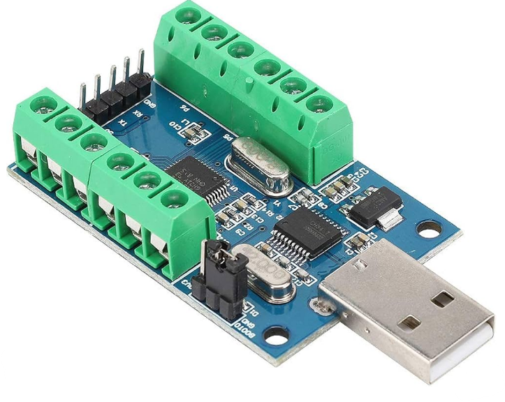

# USB_ADC — firmware du module d'acquisition USB (STM32F103C6 + CH340)

<p align="center"></p>

Firmware de remplacement pour un module d'acquisition low cost à 10 voies analogiques (carte vendue comme
« STM32F103C8T6 », micro réel **STM32F103C6** : 32 Ko de flash, 10 Ko de RAM, Chip ID 0x412), avec convertisseur
USB-série CH340 (VID:PID `1A86:7523`).

## Matériel
| Élément | Configuration |
|---|---|
| Horloge | HSE 8 MHz → PLL ×9 → 72 MHz ; ADC 12 MHz (PCLK2 / 6) |
| ADC1 | IN0..IN9 = PA0..PA7, PB0, PB1 (rangs 1 à 10), 239,5 cycles, scan continu, DMA1 Channel1 circulaire |
| USART1 | PA9 TX / PA10 RX, 115 200 bauds 8N1, vers le CH340 |
| Entrées | broches du micro directement sur le connecteur : **0 à 3,3 V**, sans pont diviseur ni protection |

Mesure : référence = 3,3 V du module (pas de référence externe, pas d'étalonnage d'usine de VREFINT sur F103) ; la
conversion en volts et l'étalonnage par voie sont faits côté PC.

## Protocole (un caractère, sensible à la casse, sans fin de ligne)
Identique au firmware d'origine du module (v1.4), les outils PC existants restent utilisables :

| Envoi | Réponse |
|---|---|
| `0` … `9` | valeur de la voie (0 … 4095) terminée par `\n` |
| `A` | toutes les voies, chacune suivie d'un espace, puis `\n` (ex. `2022 2195 … 2193 \n`) |
| `V` | identification du firmware, ex. `USB_ADC v2.0 03/11/2026\n` |
| tout autre caractère (minuscules, `\r`, `\n`, voie non convertie…) | `?\n` |

Écart avec l'origine : chaque valeur est la moyenne glissante des 64 derniers scans DMA (≈ 11 ms), calculée à la
demande. Comme l'origine, un caractère reçu pendant l'émission d'une réponse est perdu (envoyer une commande à la fois
et attendre la réponse).

## Compilation
Projet STM32CubeMX `USB_ADC.ioc` (génération CMake), compilateur GNU Tools for STM32 (`arm-none-eabi-gcc`) :
```sh
cmake --preset Release && cmake --build build/Release    # → build/Release/USB_ADC.elf
```
Code utilisateur uniquement entre les balises `USER CODE` de `Core/Src/main.c`.

## Chargement (bootloader ROM par l'UART, pas de ST-LINK)
1. Mettre le cavalier **BOOT0 à 1** (P1), puis **débrancher / rebrancher l'USB** (pas de bouton reset, DTR / RTS du
   CH340 non câblés). Ne rien envoyer sur le port avant STM32_Programmer_CLI : le bootloader ROM règle sa vitesse sur
   le premier octet reçu (0x7F) et ne se resynchronise qu'au reset suivant.
2. Flasher par le port série du CH340 (le bootloader ROM du F103 écoute sur USART1 PA9 / PA10) :
   ```sh
   STM32_Programmer_CLI -c port=COMx br=115200 -w build/Release/USB_ADC.elf -v
   ```
3. Remettre **BOOT0 à 0**, puis reset : le firmware démarre.

Vérification : `python -c "import serial; s=serial.Serial('COMx',115200,timeout=0.2); s.write(b'V'); print(s.readline())"`.
